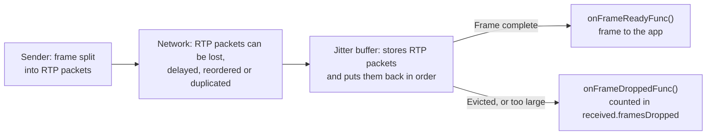
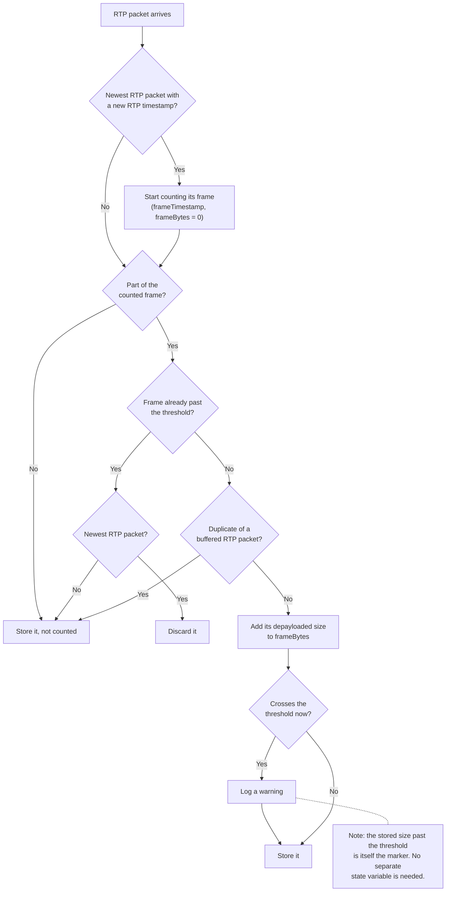
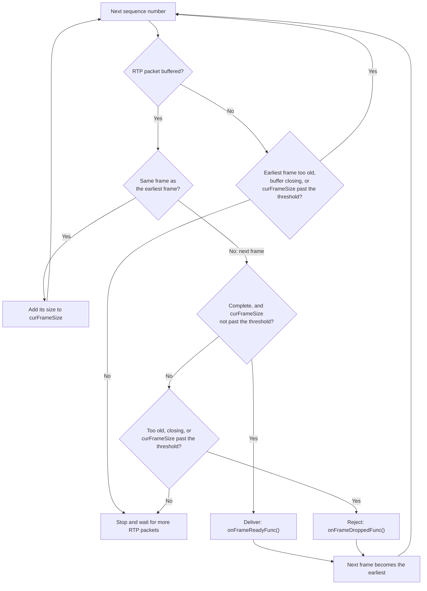

# Frame Size Limits

## What this covers

The KVS WebRTC C library is a full WebRTC stack. It limits the size of a single media frame in both directions. This document lists the limits, what happens when a frame exceeds one, and what to do instead.

## Summary

| Direction | Define | Value | What happens to a larger frame | Error | Stats |
|-----------|--------|-------|--------------------------------|-------|-------|
| Outbound | `MAX_OUTBOUND_FRAME_SIZE_BYTES` | 5 MiB (5,242,880 bytes) | `writeFrame()` rejects it. Nothing is sent. | `writeFrame()` returns `STATUS_RTP_OUTBOUND_FRAME_TOO_LARGE` (`0x5c000005`) | None |
| Inbound | `MAX_INBOUND_FRAME_SIZE_BYTES` | 5 MiB (5,242,880 bytes) | The peer connection rejects it and continues with the next frame. | WARN log with `STATUS_RTP_INBOUND_FRAME_TOO_LARGE` (`0x5c000006`) | `received.framesDropped` |

Both limits are defined in [Include.h](../src/include/com/amazonaws/kinesis/video/webrtcclient/Include.h).

---

## Outbound (`MAX_OUTBOUND_FRAME_SIZE_BYTES`)

### Behavior

`writeFrame()` checks the frame size first. If the frame is larger than `MAX_OUTBOUND_FRAME_SIZE_BYTES`, `writeFrame()`:

- logs an error: `Frame size <size> exceeds the maximum outbound frame size 5242880`,
- returns `STATUS_RTP_OUTBOUND_FRAME_TOO_LARGE`,
- sends nothing and leaves the outbound RTP stats unchanged.

A frame of exactly `MAX_OUTBOUND_FRAME_SIZE_BYTES` is sent.

### Why there is a limit

The limit protects both ends of the session:

- **The sending device:** `writeFrame()` holds the SRTP session lock while it packetizes, encrypts and sends a frame. The transceiver's payload buffer also grows to the largest frame sent and keeps that size.
- **The receiver:** RTP has no frame size limit of its own, but every receiver buffers a bounded number of RTP packets per frame. If a frame is larger than the receiver can reassemble, the receiver never delivers it and may stop delivering video for the rest of the session.

Browsers built on libwebrtc (Chrome, Edge, Safari) buffer at most 2048 RTP packets for all incomplete frames together. So a frame can be at most about 2.4 MB at the default MTU. If browsers are viewers, keep frames well below that.

Real video frames, including 4K keyframes, are far below 5 MiB.

### If a frame is rejected

- **Video:** check the encoder settings (bitrate, keyframe size).
- **Files and other large payloads:** send them over a data channel with `dataChannelSend()`, split into smaller messages. Do not send them as video frames.
- **Use cases that need larger frames:** change `MAX_OUTBOUND_FRAME_SIZE_BYTES` in [Include.h](../src/include/com/amazonaws/kinesis/video/webrtcclient/Include.h) and rebuild the library. Make sure your receivers can reassemble frames of that size. If a receiver uses this library, also raise its `MAX_INBOUND_FRAME_SIZE_BYTES`.

## Inbound (`MAX_INBOUND_FRAME_SIZE_BYTES`)

### Behavior

The peer connection measures a received frame at the size it would deliver to the application. That size includes a 4-byte start code before each H.264/H.265 NAL unit. If a frame is larger than `MAX_INBOUND_FRAME_SIZE_BYTES`, the peer connection:

- logs a warning when the frame crosses the threshold: `Rejecting frame with timestamp <timestamp>: larger than the maximum inbound frame size 5242880 (0x5c000006)`,
- rejects the whole frame, so the application's `transceiverOnFrame()` callback is not called for it,
- counts it in `received.framesDropped` in the inbound RTP stats.

Later frames are delivered as usual. A frame of exactly `MAX_INBOUND_FRAME_SIZE_BYTES` is delivered.

### If a received frame is rejected

- **Video:** check the sender's encoder settings (bitrate, keyframe size).
- **Use cases that need larger frames:** change `MAX_INBOUND_FRAME_SIZE_BYTES` in [Include.h](../src/include/com/amazonaws/kinesis/video/webrtcclient/Include.h) and rebuild the library. If the sender uses this library, also raise its `MAX_OUTBOUND_FRAME_SIZE_BYTES`.

## How the jitter buffer works

This section explains how a peer connection receives video. Each transceiver of a peer connection has its own jitter buffer. Here, a *frame* is one media frame, such as one H.264 video frame. An *RTP packet* is one network packet that carries part of a frame.

### From media frames to RTP packets

- The sender splits each frame into RTP packets. At the default MTU of 1,200 bytes, a 5 MiB frame becomes about 4,400 RTP packets.
- Each RTP packet carries a sequence number and the frame's timestamp in RTP timestamp units. All RTP packets of a frame share the same RTP timestamp.
- On the network, an RTP packet can be lost, delayed, reordered or duplicated.

With VERBOSE logging (`AWS_KVS_LOG_LEVEL=1` in the samples), `writeFrame()` logs one line for each frame it sends:

```
2026-10-17 08:14:59.730 VERBOSE writeFrame(): debug frame info: track=video, pts=13200000, rtpTs=118799, size=706B, rtpPayload=690B, wireSize=840B, seqNums=168-172, keyFrame=no
```

| Field        | Meaning                                                                                                        |
|--------------|----------------------------------------------------------------------------------------------------------------|
| `pts`        | Presentation timestamp passed to `writeFrame()`, in 100 ns units                                               |
| `rtpTs`      | The same time in RTP timestamp units (90 kHz for video)                                                        |
| `size`       | Frame size passed to `writeFrame()`                                                                            |
| `rtpPayload` | Total RTP payload after packetization. H.264/H.265 start codes are removed and RTP fragment headers are added. |
| `wireSize`   | Bytes sent on the wire: RTP headers, payload and SRTP overhead                                                 |
| `seqNums`    | Sequence numbers of the frame's RTP packets                                                                    |

In this example, the 706-byte frame was sent as 5 RTP packets (sequence numbers 168 to 172). The H.264 sender gives each NAL unit that fits in an RTP packet its own RTP packet, so this frame had 5 NAL units.

### What the jitter buffer does

- The jitter buffer stores each RTP packet as it arrives, keyed by sequence number.
- It puts the RTP packets back in order and groups them into frames by RTP timestamp.
- A frame is complete when none of its RTP packets are missing and the first RTP packet of the next frame arrives. Once a frame is complete, the jitter buffer delivers it to the application through `onFrameReadyFunc()`.



#### Late frames

- The jitter buffer compares RTP timestamps with the newest RTP packet it has received. An incomplete frame more than 2 seconds older than the newest RTP packet is evicted. An RTP packet that is already more than 2 seconds older when it arrives is discarded.
- The window is relative to the newest RTP packet, so a steady network delay, such as a distant viewer, doesn't count. Only jitter or reordering of more than 2 seconds does. A frame with a lost RTP packet also waits for eviction, because the library does not ask the sender to resend it.
- The eviction window is `DEFAULT_JITTER_BUFFER_MAX_LATENCY` (2 seconds). To change it, edit the value in [Include.h](../src/include/com/amazonaws/kinesis/video/webrtcclient/Include.h) and rebuild the library.

### The inbound size limit in the code

`JitterBuffer.c` applies `MAX_INBOUND_FRAME_SIZE_BYTES` in two steps, shown in the diagrams below:

1. `jitterBufferPush()` runs for each RTP packet. It counts the size of the newest frame, then stores or discards the RTP packet.
2. `jitterBufferPush()` then calls `jitterBufferInternalParse()`. Parse walks the buffer from the earliest frame, then delivers or rejects that frame.

Here, the *threshold* is `MAX_INBOUND_FRAME_SIZE_BYTES`.

- **Problem:** a frame's size is only known as its RTP packets arrive. Once a frame crosses the threshold, push discards the frame's newer RTP packets. Parse only sees the RTP packets left in the buffer, and those can look like a complete frame, or like a frame waiting for a lost or late RTP packet. Parse must tell the oversized frame apart from both, so that it rejects the frame instead of delivering it or waiting for eviction.
- **Solution:** push keeps the one RTP packet that crosses the threshold. That RTP packet puts the frame's stored size past the threshold. Parse adds up each frame's stored size (`curFrameSize`) and rejects a frame whose size is past the threshold. No extra state is needed.
- **Late RTP packets:** push keeps late RTP packets of the frame, so they fill their gaps. RTP packets that arrive after the first RTP packet of the next frame are not counted. So a frame that only goes past the threshold through those RTP packets is rejected without the warning. If an RTP packet before the crossing point is lost, the frame waits for eviction like any incomplete frame.
- **Bound:** a frame larger than `MAX_INBOUND_FRAME_SIZE_BYTES` is never delivered. The jitter buffer holds at most the threshold, plus one RTP packet, plus the frame's reordered RTP packets, before it rejects the frame.

In both diagrams, "too old" means past the eviction window. Every "Store" still discards an RTP packet that arrives too old.

#### `jitterBufferPush()`: count and discard



#### `jitterBufferInternalParse()`: deliver or reject the earliest frame



An oversized frame is missing the sequence numbers of its discarded RTP packets. Parse skips those missing sequence numbers. When parse reaches the first RTP packet of the next frame, it rejects the oversized frame.

## Troubleshooting

### Video stops at the viewer

A frame that is too large for the viewer is one possible cause. Check the sender first, then the viewer.

**C sender:** look for this error in the logs, or a `STATUS_RTP_OUTBOUND_FRAME_TOO_LARGE` return from `writeFrame()`:

```
Frame size <size> exceeds the maximum outbound frame size 5242880
```

If it appears, see [If a frame is rejected](#if-a-frame-is-rejected).

**Browser viewer:** open `chrome://webrtc-internals` (`edge://webrtc-internals` in Edge, `about:webrtc` in Firefox) in a new tab **before** you start the session, then join. Under the inbound video track (`inbound-rtp` … `kind=video`):

- **`packetsReceived` / `bytesReceived` keep climbing but `framesReceived` stops:** RTP packets arrive but the browser can't reassemble them into frames. Compare the size of the frames you send with the browser limit in [Why there is a limit](#why-there-is-a-limit).
- **`freezeCount` / `totalFreezesDuration`:** confirms and quantifies the freeze.

**C viewer:** look for the `larger than the maximum inbound frame size` warning in the logs. If it appears, see [If a received frame is rejected](#if-a-received-frame-is-rejected). Otherwise, call `rtcPeerConnectionGetMetrics()` with `RTC_STATS_TYPE_INBOUND_RTP` for the video transceiver. In `inboundRtpStreamStats`:

- **`received.packetsReceived` keeps climbing but `framesReceived` stops:** RTP packets arrive but the peer connection can't reassemble them into frames.
- **`received.packetsDiscarded` keeps climbing:** the jitter buffer is discarding RTP packets, for example because they are past the eviction window or belong to an oversized frame.
- **`received.framesDropped` keeps climbing:** the jitter buffer is rejecting or evicting frames.

For other causes of a freeze, see [Debugging from the receiver](TROUBLESHOOTING_H265_FRAMES.md#debugging-from-the-receiver-chrome).

### Inspect RTP packets with Wireshark

Use [Wireshark](https://www.wireshark.org/) to inspect the RTP packets on the network. SRTP encrypts the payload but not the RTP header, so each RTP packet's sequence number and RTP timestamp are readable. Check that the sequence numbers match the `seqNums` range in the `writeFrame()` log. On the receiver, missing sequence numbers, duplicates or reordering come from the network.

If Wireshark shows the RTP packets as plain UDP, enable the `rtp_udp` protocol in **Analyze > Enabled Protocols**.

## References

- [RFC 3550](https://datatracker.ietf.org/doc/html/rfc3550) - RTP
- Code: `Rtp.c` (`writeFrame()`), `JitterBuffer.c` (inbound limit), `Include.h` (`MAX_OUTBOUND_FRAME_SIZE_BYTES`, `MAX_INBOUND_FRAME_SIZE_BYTES`, `STATUS_RTP_OUTBOUND_FRAME_TOO_LARGE`, `STATUS_RTP_INBOUND_FRAME_TOO_LARGE`, `dataChannelSend()`)
