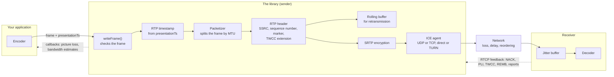

# Sending Media with writeFrame(): Timestamps, Packetization, and Feedback

## What this covers

This document covers the outbound media flow: how each frame travels from the camera, through the KVS WebRTC C library and the network, to the remote peer. The library is a full WebRTC stack. Your application captures and encodes the media and passes each encoded frame to `writeFrame()`. The library packages the frame into RTP packets, encrypts them with SRTP, and sends them over the network to the remote peer. It does not decode, re-encode, or retime the media.

The document starts with how to call `writeFrame()`, first for one video track and then for audio and video together. It then follows the frame through the library and the network, explains how the remote peer's feedback affects delivery, and ends with troubleshooting for timestamp and packet loss problems.

Here, a *frame* is one encoded media frame, such as one H.264 access unit or one Opus frame. An *RTP packet* is one network packet that carries all or part of a frame. Other terms used in this document:

- **Transceiver:** the library object for one media track, such as the video or the audio. It matches one media section (`m=` line) in the SDP.
- **SDP:** the offer and answer that the two peers exchange to agree on tracks, codecs and options.
- **DTLS and SRTP:** DTLS is the handshake that sets up the encryption keys. SRTP is the encrypted form of RTP that carries the media.
- **RTCP:** the control messages that travel alongside RTP, such as sender reports, receiver reports, and feedback.
- **SSRC:** the number that identifies one RTP stream.
- **NAL unit:** one unit of H.264 or H.265 data. A video frame (access unit) consists of one or more NAL units.

## Send video: a minimal example

Sending video takes four steps:

1. Configure the encoder when you initialize it: codec and output format, frame rate, keyframe interval, resolution, and bitrate (see [Encoder settings](#encoder-settings)).
2. Add one transceiver for the track when you set up the peer connection.
3. Wait until the peer connection is connected. The KVS library can encrypt media only after the DTLS handshake completes. To get the first frame out quickly, start the capture and the encoder in parallel with the connection setup, for example when the remote peer's offer arrives.
4. For each encoded frame, fill in a `Frame` and call `writeFrame()`.

```c
// 1. Initialize the encoder with the settings in the next section

// 2. Once, when you set up the peer connection
RtcMediaStreamTrack videoTrack;
RtcRtpTransceiverInit videoInit;
PRtcRtpTransceiver pVideoTransceiver = NULL;

MEMSET(&videoTrack, 0x00, SIZEOF(RtcMediaStreamTrack));
videoTrack.kind = MEDIA_STREAM_TRACK_KIND_VIDEO;
videoTrack.codec = RTC_CODEC_H264_PROFILE_42E01F_LEVEL_ASYMMETRY_ALLOWED_PACKETIZATION_MODE;
STRCPY(videoTrack.streamId, "myKvsVideoStream");
STRCPY(videoTrack.trackId, "myVideoTrack");
// Options for the new transceiver, like RTCRtpTransceiverInit in the W3C WebRTC API. Passing NULL means SENDRECV.
videoInit.direction = RTC_RTP_TRANSCEIVER_DIRECTION_SENDONLY;
addTransceiver(pPeerConnection, &videoTrack, &videoInit, &pVideoTransceiver);

// 3. Start sending once the peer connection reports RTC_PEER_CONNECTION_STATE_CONNECTED
//    (onConnectionStateChange is defined below)
peerConnectionOnConnectionStateChange(pPeerConnection, (UINT64) pMyApp, onConnectionStateChange);

// 4. For each encoded frame
Frame frame;
MEMSET(&frame, 0x00, SIZEOF(Frame));
frame.flags = isKeyFrame ? FRAME_FLAG_KEY_FRAME : FRAME_FLAG_NONE;
frame.presentationTs = captureTime - firstCaptureTime; // 100 ns units, 0 for the first frame
frame.frameData = pEncodedFrame; // one complete encoded frame, Annex B for H.264 and H.265
frame.size = encodedFrameSize;

STATUS status = writeFrame(pVideoTransceiver, &frame);
```

```c
VOID onConnectionStateChange(UINT64 customData, RTC_PEER_CONNECTION_STATE newState)
{
    if (newState == RTC_PEER_CONNECTION_STATE_CONNECTED) {
        // Ask the already running encoder for a keyframe, and start presentationTs at 0 with it
    }
}
```

A peer connection has one connection state callback. If your code already registers one, as the samples do, add the check to it.

The samples follow the same pattern: `samples/common/GstMedia.c` sends frames from a GStreamer encoder, and `samples/common/StaticMedia.c` sends pre-encoded frames from files.

### Encoder settings

The KVS library sends the encoded data as it is, so the encoder settings decide what the receiver gets. Set them when you initialize the encoder. On embedded boards, this is usually the camera vendor's hardware encoder API. The parameter names vary by vendor:

```c
// Hardware encoder setup (names vary by vendor SDK)
encoderParams.codec = ENCODER_CODEC_H264;      // the transceiver's codec
encoderParams.width = 1280;
encoderParams.height = 720;
encoderParams.fps = 30;                        // the capture rate
encoderParams.gopLength = 30;                  // keyframe interval in frames: 30 frames is 1 second at 30 fps
encoderParams.rateControl = ENCODER_RC_CBR;    // constant bitrate
encoderParams.bitrate = 1000000;               // bits per second, and the starting point for adaptive bitrate
encoderParams.bFrames = 0;                     // no B-frames
encoderParams.outputFormat = ENCODER_ANNEX_B;  // start code before each NAL unit
encoderParams.repeatParameterSets = TRUE;      // SPS and PPS (and VPS for H.265) before every keyframe
encoderInit(&encoder, &encoderParams);

// The encoder's output callback returns each encoded frame with the timestamp of the raw frame
// it came from, which the camera set at capture
VOID onEncodedFrame(PBYTE pData, UINT32 size, UINT64 timestamp, BOOL isKeyFrame)
{
    frame.presentationTs = timestamp - firstTimestamp; // converted to 100 ns units if needed
    // ...fill in the other fields and call writeFrame()
}
```

Most camera and encoder APIs work this way: the camera driver stamps each raw frame when it captures it, and the encoder returns the same timestamp with the encoded frame. Use that timestamp. Check in the encoder's documentation that it is the capture time carried through, and not the time that encoding finished.

| Setting                 | Recommendation                                                                                                                                               | Why                                                                                                                                                                                                                                          |
|-------------------------|--------------------------------------------------------------------------------------------------------------------------------------------------------------|----------------------------------------------------------------------------------------------------------------------------------------------------------------------------------------------------------------------------------------------|
| Codec and output format | The transceiver's codec. For H.264 and H.265, an Annex B byte stream with one complete frame per output buffer, and the parameter sets before every keyframe | The packetizer finds NAL units by their start codes, and a receiver that misses the first keyframe needs the parameter sets in a later one (see [Troubleshooting H.265 Video Frames](TROUBLESHOOTING_H265_FRAMES.md))                        |
| B-frames                | Off                                                                                                                                                          | The library sends frames in the order of the `writeFrame()` calls, and each frame's timestamp needs to be larger than the one before it (see [Timestamp guidelines](#timestamp-guidelines))                                                  |
| Frame rate              | The capture rate                                                                                                                                             | It sets how far `presentationTs` advances per frame                                                                                                                                                                                          |
| Keyframe interval       | Short, such as 0.5 to 1 second                                                                                                                               | Without NACK, each freeze after a lost frame lasts until the next keyframe, and a short interval makes answering keyframe requests optional (see [Feedback from the receiver](#feedback-from-the-receiver)). Each keyframe costs extra bits. |
| Resolution and bitrate  | What the network can carry, with keyframes well below the receiver's frame size limit (see [Frame Size Limits](FRAME_SIZE_LIMITS.md))                        | A bitrate higher than the network can carry leads to loss and delay. With adaptive bitrate, this is the starting bitrate (see [TWCC](TWCC.md)).                                                                                              |
| Latency                 | A low-latency mode without lookahead                                                                                                                         | Lookahead holds frames inside the encoder, which adds delay before `writeFrame()`                                                                                                                                                            |

The GStreamer samples in `samples/common/GstMedia.c` set some of these on `x264enc`: `bframes=0`, `tune=zerolatency`, and a starting bitrate of 512 kbps. They keep the `x264enc` default keyframe interval of about 10 seconds.

### The Frame fields

`writeFrame()` reads four fields of the `Frame`: `presentationTs`, `frameData`, `size`, and `flags`.

| Field            | Type          | Read by `writeFrame()`                    | What to set                                                                                                                                                                                                                                                       |
|------------------|---------------|-------------------------------------------|-------------------------------------------------------------------------------------------------------------------------------------------------------------------------------------------------------------------------------------------------------------------|
| `presentationTs` | `UINT64`      | Yes. It becomes the RTP timestamp.        | The frame's capture time in 100 ns units, following the [timestamp guidelines](#timestamp-guidelines)                                                                                                                                                             |
| `frameData`      | `PBYTE`       | Yes                                       | One complete encoded frame. For H.264 and H.265, use Annex B format, with a start code before each NAL unit and the parameter sets (SPS, PPS, and VPS for H.265) before each keyframe (see [Troubleshooting H.265 Video Frames](TROUBLESHOOTING_H265_FRAMES.md)). |
| `size`           | `UINT32`      | Yes                                       | The number of bytes in `frameData`, up to 5 MiB (see [Frame Size Limits](FRAME_SIZE_LIMITS.md))                                                                                                                                                                   |
| `flags`          | `FRAME_FLAGS` | Only for statistics and the per-frame log | `FRAME_FLAG_KEY_FRAME` for a keyframe, otherwise `FRAME_FLAG_NONE`                                                                                                                                                                                                |
| `decodingTs`     | `UINT64`      | No                                        | Not needed. RTP carries one timestamp per frame, which the KVS library takes from `presentationTs`.                                                                                                                                                               |
| `duration`       | `UINT64`      | No                                        | 0, or the frame duration                                                                                                                                                                                                                                          |
| `version`        | `UINT32`      | No                                        | 0, the version of the `Frame` fields in this table. The `MEMSET` sets it. Avoid `FRAME_CURRENT_VERSION`: if a later release raises it, your code would claim a newer version without setting its new fields.                                                      |
| `index`          | `UINT32`      | No                                        | Optional frame counter                                                                                                                                                                                                                                            |
| `trackId`        | `UINT64`      | No                                        | Optional. The transceiver that you pass to `writeFrame()` selects the track.                                                                                                                                                                                      |

### Timestamp guidelines

The KVS library sends each frame's timestamp as given. Receivers expect the RTP timestamps of each track to increase monotonically and linearly with time ([RFC 3550, section 5.1](https://datatracker.ietf.org/doc/html/rfc3550#section-5.1)), so set `presentationTs` as follows:

- **Start at 0** with the first frame that the library sends on the track (see [Send audio and video together](#send-audio-and-video-together)).
- **Increase it with every frame**, and call `writeFrame()` in that order.
- **Advance it at real time**, by the time between captures. For example, add `HUNDREDS_OF_NANOS_IN_A_SECOND / 30` (333,333) per frame at 30 frames per second, or `20 * HUNDREDS_OF_NANOS_IN_A_MILLISECOND` (200,000) per 20 ms Opus frame.
- **Give each frame its own timestamp.** Two frames of a track with the same `presentationTs` get the same RTP timestamp. Receivers group RTP packets into frames by RTP timestamp, so a receiver can treat the two frames as one. To keep the NAL units of one video frame together, pass them all in one `writeFrame()` call.

#### Where the timestamp comes from

| Source                                                                                                    | Result                                                                                                                                                                                                                          |
|-----------------------------------------------------------------------------------------------------------|---------------------------------------------------------------------------------------------------------------------------------------------------------------------------------------------------------------------------------|
| The capture timestamp that the encoder returns with each encoded frame, minus the first frame's timestamp | Recommended. The spacing matches the real captures, and a dropped frame leaves a gap of the right length.                                                                                                                       |
| A frame counter: add the frame duration for each frame, as the samples do                                 | Even spacing, regardless of when `writeFrame()` runs. The timestamps drift from real time if the actual capture rate differs from the nominal rate.                                                                             |
| `GETTIME()` when calling `writeFrame()`                                                                   | Not recommended. The time includes encoding and scheduling delays, so their jitter appears in the timestamps. Two frames that leave a queue together get almost the same timestamp, and the receiver plays them almost at once. |

If you read a clock, read it when the frame is captured, and use a monotonic clock, such as `CLOCK_MONOTONIC` on Linux, converted to 100 ns units. `GETTIME()` reads the system wall clock by default (`CLOCK_REALTIME` on Linux), which jumps when the device sets its time, for example at its first NTP sync after boot.

Receivers schedule playout from the RTP timestamps and the arrival times of the RTP packets. When `presentationTs` jumps, the receiver sees the same jump: depending on the receiver, the video freezes, skips, or plays too fast until the receiver resynchronizes. When `presentationTs` goes backward, the receiver can deliver frames out of order.

### What writeFrame() returns

`writeFrame()` checks these conditions in order. It does not check `presentationTs`, and sends the value as given.

| Condition                                                | Result                                                          | Action                                                                                                                                     |
|----------------------------------------------------------|-----------------------------------------------------------------|--------------------------------------------------------------------------------------------------------------------------------------------|
| The transceiver or the frame is NULL                     | Returns `STATUS_NULL_ARG`                                       | Pass the transceiver from `addTransceiver()` and a filled-in `Frame`.                                                                      |
| The frame is larger than `MAX_OUTBOUND_FRAME_SIZE_BYTES` | Returns `STATUS_RTP_OUTBOUND_FRAME_TOO_LARGE` and sends nothing | Keep frames below 5 MiB, for example by lowering the encoder bitrate or the keyframe size (see [Frame Size Limits](FRAME_SIZE_LIMITS.md)). |
| The transceiver direction is `INACTIVE` or `RECVONLY`    | Returns `STATUS_SUCCESS` and sends nothing                      | Add the transceiver with `SENDONLY` or `SENDRECV`, and check that the remote peer's SDP lets this side send.                               |
| DTLS has not completed, so SRTP is not ready             | Returns `STATUS_SRTP_NOT_READY_YET` and sends nothing           | Start sending only after the peer connection reports `RTC_PEER_CONNECTION_STATE_CONNECTED`, beginning with a keyframe.                     |
| An H.264 or H.265 frame does not start with a start code | Returns `STATUS_RTP_INVALID_NALU` and sends nothing             | Configure the encoder for Annex B output. Encoders that output length-prefixed NAL units (AVCC) need a conversion to Annex B first.        |

An unsupported codec is rejected earlier: `addTransceiver()` returns `STATUS_NOT_IMPLEMENTED` for it. The supported codecs are H.264, H.265, VP8, Opus, and G.711 (PCMU, PCMA).

If all checks pass, the KVS library sends the frame and returns `STATUS_SUCCESS`. Frames that return `STATUS_SRTP_NOT_READY_YET` are not sent, so the first frame that the library sends is the first one after DTLS completes. That frame needs to be a keyframe, so that the receiver can start decoding.

> [!NOTE]
> `STATUS_SUCCESS` means that the library accepted the frame and handed its RTP packets to the ICE agent for sending. It does not confirm that each RTP packet left the device or arrived. WebRTC media runs over UDP/SRTP, which does not guarantee delivery, so an RTP packet that left the device can still be lost on the way (see [Network factors](#network-factors)). An RTP packet that the socket fails to send is counted in the candidate pair stats (see [How the RTP packets are sent](#how-the-rtp-packets-are-sent)).

## Send audio and video together

To send audio as well, add a second transceiver with `kind = MEDIA_STREAM_TRACK_KIND_AUDIO` and an audio codec, such as `RTC_CODEC_OPUS`, and call `writeFrame()` on it for each audio frame. Compared with video only, two tracks add the following:

- **Two independent tracks.** Each transceiver has its own SSRC, its own sequence numbers, its own RTP clock (90,000 Hz for video, 48,000 Hz for Opus), and its own sender reports. The KVS library never compares the timestamps of different tracks.
- **Different frame rates.** Audio frames typically arrive every 20 ms and video frames every 33 or 40 ms. Each Opus frame fits in one RTP packet, and a video frame often needs several.
- **Separate threads.** You can call `writeFrame()` for audio and video from separate threads, as the samples do. The order in which the calls for the two tracks interleave does not matter.
- **One media stream.** Give both tracks the same `streamId`, as the samples do. The library writes it into the SDP `msid` attribute, which tells the receiver that the two tracks belong to one media stream, so that a browser can synchronize them.
- **Audio/video synchronization.** The receiver lines the tracks up using RTCP sender reports. Each sender report maps the track's RTP time to the device's wall-clock time, counted from the moment the library sent the track's first frame (see [Sender reports](#sender-reports)).

The library times each track's sender reports from the moment it sends that track's first frame. As a result, audio and video line up when **the first frame that the library sends on each track carries the same `presentationTs`, ideally 0**. The receiver can line the tracks up once their sender reports arrive, about 2.5 seconds after each track's first frame. Two ways to achieve this:

- Start each track at `presentationTs` 0 once the peer connection is connected, even if one track starts later than the other.
- Take both tracks' timestamps from one clock, and start both tracks at the same time.

Because of this timing, two situations offset the tracks:

- **Tracks that share a timestamp base but start at different times.** For example, if video starts 2 seconds after audio and its first frame has `presentationTs` 2 seconds, the receiver plays the video 2 seconds late.
- **Timestamps that keep advancing while frames return `STATUS_SRTP_NOT_READY_YET`.** For example, if audio starts counting 0.5 seconds before video and both tracks wait for DTLS, the first frames sent carry different timestamps, and the tracks are 0.5 seconds apart.

Two other effects can still offset the tracks. A track whose timestamps run faster or slower than the device clock drifts away from the other track over time. A difference between the tracks in the delay from capture to the first `writeFrame()` call becomes a constant offset between them.

## How the library sends a frame

### Architecture



### What your application does and what the library does

| Area                        | Your application                                                                                                                                                                                                    | The KVS library                                                                                                      |
|-----------------------------|---------------------------------------------------------------------------------------------------------------------------------------------------------------------------------------------------------------------|----------------------------------------------------------------------------------------------------------------------|
| Frame timestamps            | Sets `presentationTs` from its capture clock                                                                                                                                                                        | Converts `presentationTs` to RTP clock units without adjusting it                                                    |
| Audio/video synchronization | Gives the tracks timestamps that line up (see [Send audio and video together](#send-audio-and-video-together))                                                                                                      | Sends a sender report for each track                                                                                 |
| Frame content               | Encodes the media and passes one complete frame per `writeFrame()` call                                                                                                                                             | Splits the frame into RTP packets that fit the MTU, without changing the encoded data                                |
| Frame order and timing      | Calls `writeFrame()` in decoding order, as frames come out of the encoder                                                                                                                                           | Sends the frame's RTP packets immediately, in the order of the calls                                                 |
| Keyframes                   | Chooses the keyframe interval and sends a keyframe at the start. Answering keyframe requests (PLI): with a short keyframe interval, such as 0.5 to 1 second, the application can wait for the next natural interval | Reports keyframe requests through `transceiverOnPictureLoss()`                                                       |
| Bitrate                     | Decides whether to adapt the bitrate: it can follow the bandwidth callbacks (adaptive or dynamic bitrate) or keep a constant bitrate                                                                                | Reports TWCC and REMB feedback through the bandwidth callbacks, if registered (see [TWCC](TWCC.md))                  |
| Frame size                  | Keeps frames within the limits                                                                                                                                                                                      | Rejects a frame larger than 5 MiB (see [Frame Size Limits](FRAME_SIZE_LIMITS.md))                                    |
| Loss recovery               | Relies on the next scheduled keyframe, or sends one early when the receiver asks with PLI                                                                                                                           | Resends lost RTP packets that the receiver asks for, if the receiver negotiated NACK (see [NACK / RTX](NACK_RTX.md)) |

### The RTP timestamp

`writeFrame()` computes the RTP timestamp from `presentationTs` alone:

```
rtpTimestamp = presentationTs × clockRate / 10,000,000
```

`presentationTs` is in 100 ns units. The clock rate depends on the codec:

| Codec              | Clock rate (Hz) | RTP timestamp wraps after |
|--------------------|----------------:|---------------------------|
| H.264, H.265, VP8  | 90,000          | 13 h 15 min               |
| Opus               | 48,000          | 24 h 51 min               |
| G.711 (PCMU, PCMA) | 8,000           | 6 days 5 h                |

- The conversion truncates a floating-point product, so the RTP timestamp can be one tick below the exact value. In the [per-frame log](#log-each-frame-the-sender-sends) example, `pts=13200000` becomes `rtpTs=118799`, not 118,800.
- The RTP header holds 32 bits, so the RTP timestamp wraps to 0 after the times in the table. Receivers handle the wrap.
- The KVS library adds no random offset, so the RTP timestamp starts at the converted `presentationTs` of the first frame.
- Every RTP packet of a frame carries the same RTP timestamp.

### The RTP packets of a frame

- **Sequence numbers:** each transceiver numbers its RTP packets with a 16-bit sequence number that increases by 1 for each RTP packet, across frames, and wraps after 65,535.
- **SSRC:** each transceiver sends its media on its own SSRC. Retransmissions use a separate RTX SSRC when RTX is negotiated (see [NACK / RTX](NACK_RTX.md)).
- **Marker bit:** set on the last RTP packet of each frame.
- **TWCC extension:** if TWCC is negotiated, every RTP packet carries a header extension with a transport-wide sequence number. The extension does not change the RTP timestamp (see [TWCC](TWCC.md)).

The packetizer splits a frame so that each RTP payload is at most the MTU, which is 1,200 bytes by default (`DEFAULT_MTU_SIZE_BYTES`). The RTP header, the TWCC extension, and SRTP add about 30 bytes to each RTP packet.

| Codec | How the frame is split                                                                                                                                                                                                                                                                                   |
|-------|----------------------------------------------------------------------------------------------------------------------------------------------------------------------------------------------------------------------------------------------------------------------------------------------------------|
| H.264 | The packetizer finds each NAL unit by its start code (3 or 4 bytes) and removes the start code. A NAL unit that fits in one RTP packet gets its own RTP packet. A larger NAL unit is split into FU-A fragments.                                                                                          |
| H.265 | Same as H.264, with H.265 fragmentation units.                                                                                                                                                                                                                                                           |
| VP8   | The frame is split into RTP packets of up to the MTU, each with a VP8 payload descriptor.                                                                                                                                                                                                                |
| Opus  | The whole frame goes into one RTP packet, whatever its size. The packetizer ignores the MTU, because the Opus RTP payload format ([RFC 7587](https://datatracker.ietf.org/doc/html/rfc7587)) carries exactly one Opus packet per RTP packet. A 20 ms frame at 128 kbps is 320 bytes, well below the MTU. |
| G.711 | The frame is split into RTP packets of up to the MTU.                                                                                                                                                                                                                                                    |

### How the RTP packets are sent

For each RTP packet of the frame, `writeFrame()` stores a copy in the transceiver's rolling buffer for retransmission, encrypts it with SRTP, and hands it to the ICE agent.

If the socket fails to send an RTP packet, the ICE agent logs `iceUtilsSendData failed`, counts the RTP packet in `packetsDiscardedOnSend` in the candidate pair stats (`RTC_STATS_TYPE_CANDIDATE_PAIR`), and the library continues with the rest of the frame. `writeFrame()` still returns `STATUS_SUCCESS`, and the receiver sees the RTP packet as lost.

### Sender reports

The receiver uses RTCP sender reports to map each track's RTP timestamps to wall-clock time, and lines up audio and video with that mapping. The KVS library starts a track's sender report clock when it actually sends the track's first frame. From 2.5 seconds after that, the peer connection sends a sender report for the track every 100 to 300 ms. Each sender report carries the current device time as an NTP timestamp, the matching RTP time, and the number of RTP packets and bytes sent so far. It carries no reception report blocks.

The peer connection computes the RTP time in a sender report from the time elapsed since the track's first frame was sent, not from the frames' timestamps:

```
senderReportRtpTime = (now - timeOfFirstFrameSent) × clockRate / 10,000,000
```

The receiver therefore places each frame at the time the track's first frame was sent plus the frame's `presentationTs`. This is why the first frame sent on each track should carry the same `presentationTs`, ideally 0 (see [Send audio and video together](#send-audio-and-video-together)).

## Network factors

WebRTC media runs over UDP, through SRTP. Between the sender and the receiver, an RTP packet can be lost, delayed, reordered, or duplicated.

- **Loss:** one lost RTP packet makes its whole frame incomplete. A video receiver either asks for the RTP packet again (NACK), or waits for the next keyframe. It can also ask for a keyframe early with PLI.
- **Delay and jitter:** the receiver's jitter buffer absorbs variation in arrival times. Steady delay does not affect playout. Variation that is longer than the jitter buffer can hold makes frames late.
- **Reordering and duplicates:** the jitter buffer puts RTP packets back in sequence number order and ignores duplicates.
- **TURN relays:** when ICE selects a relay candidate, RTP packets cross the TURN server. A relay adds an extra hop and some delay.
- **MTU:** an RTP packet larger than the path MTU is fragmented or dropped by the network. Lower `KvsRtcConfiguration.maximumTransmissionUnit` if your network drops large packets.

## Feedback from the receiver

The receiver reports back in RTCP. This table lists what the peer connection does with each message, and what your application can do.

| RTCP message                                             | RTCP type (PT, FMT) | What the KVS library does                                                                                       | What your application can do                                                                                                        |
|----------------------------------------------------------|---------------------|-----------------------------------------------------------------------------------------------------------------|-------------------------------------------------------------------------------------------------------------------------------------|
| Receiver report, and reception blocks in a sender report | PT 201, and PT 200  | Updates the remote inbound RTP stats: `fractionLost`, `roundTripTime`, `reportsReceived`                        | Read the stats with `rtcPeerConnectionGetMetrics()`                                                                                 |
| Generic NACK                                             | PT 205, FMT 1       | Resends the requested RTP packets from the rolling buffer, as RTX if negotiated (see [NACK / RTX](NACK_RTX.md)) | Tune the rolling buffer with `configureTransceiverRollingBuffer()` as needed, so it still holds an RTP packet when its NACK arrives |
| TWCC feedback                                            | PT 205, FMT 15      | Estimates the delay trend and calls the congestion callbacks, if any are registered (see [TWCC](TWCC.md))       | Change the encoder bitrate, or ignore the feedback                                                                                  |
| PLI (picture loss indication)                            | PT 206, FMT 1       | Counts it in `pliCount` and calls the `transceiverOnPictureLoss()` callback                                     | Send a keyframe early, or ignore it if the keyframe interval is short                                                               |
| FIR (RFC 2032)                                           | PT 192              | Counts it in `firCount` and calls the `transceiverOnPictureLoss()` callback                                     | Send a keyframe                                                                                                                     |
| REMB                                                     | PT 206, FMT 15      | Calls the `transceiverOnBandwidthEstimation()` callback with the receiver's maximum bitrate                     | Lower the encoder bitrate                                                                                                           |
| SLI                                                      | PT 206, FMT 2       | Counts it in `sliCount`                                                                                         | Nothing is needed                                                                                                                   |

Answering PLI is optional ([RFC 4585](https://datatracker.ietf.org/doc/html/rfc4585)). Keyframes are typically several times larger than the surrounding frames. Depending on the encoder, which is often a hardware block, forcing a keyframe can also flush the encoder, leave a gap, or drop frames, which the receiver sees as jitter. With a short keyframe interval, such as 0.5 to 1 second, the application can ignore PLI and rely on the next scheduled keyframe. An application that answers PLI can limit how often it forces a keyframe. Encoders differ, so test how yours behaves when it is forced to produce a keyframe, and compare both approaches on your hardware and network before you choose one.

Without NACK, nothing resends a lost RTP packet. The frame stays incomplete, and the video stays frozen or corrupted until the next complete keyframe. If the receiver does not negotiate NACK, a shorter keyframe interval shortens each freeze.

## Troubleshooting

### Log each frame the sender sends

With VERBOSE logging (`AWS_KVS_LOG_LEVEL=1` in the samples), `writeFrame()` logs one line for each frame it sends:

```
2026-10-17 08:14:59.730 VERBOSE writeFrame(): debug frame info: track=video, pts=13200000, rtpTs=118799, size=706B, rtpPayload=690B, wireSize=840B, seqNums=168-172, keyFrame=no
```

| Field        | Meaning                                                                                                        |
|--------------|----------------------------------------------------------------------------------------------------------------|
| `track`      | `video` or `audio`                                                                                             |
| `pts`        | Presentation timestamp passed to `writeFrame()`, in 100 ns units                                               |
| `rtpTs`      | The same time in RTP timestamp units (90 kHz for video)                                                        |
| `size`       | Frame size passed to `writeFrame()`                                                                            |
| `rtpPayload` | Total RTP payload after packetization. H.264/H.265 start codes are removed and RTP fragment headers are added. |
| `wireSize`   | Bytes sent on the wire: RTP headers, payload and SRTP overhead                                                 |
| `seqNums`    | Sequence numbers of the frame's RTP packets                                                                    |
| `keyFrame`   | `yes` or `no` from the frame's `FRAME_FLAG_KEY_FRAME` flag, `N/A` for audio                                    |

In this example, the 706-byte frame was sent as 5 RTP packets (sequence numbers 168 to 172). The H.264 packetizer gives each NAL unit that fits in an RTP packet its own RTP packet, so this frame had 5 NAL units.

To check timestamps, compare `pts` between consecutive frames of a track. At 30 frames per second, `pts` grows by about 333,333 per frame. Because `writeFrame()` sends `pts` as given, a larger step, a step backward, or a repeated value in `pts` also appears in the RTP timestamps at the receiver. Compare it with the timestamps of the frame source to find where the step starts.

### Inspect RTP and RTCP with Wireshark

Use [Wireshark](https://www.wireshark.org/) to look at the RTP packets on the network, on the sending device or on the receiver. SRTP encrypts the payload but not the RTP header, so each RTP packet's SSRC, sequence number, RTP timestamp, and marker bit are readable.

- **Decode RTP:** if Wireshark shows the RTP packets as plain UDP, enable the `rtp_udp` protocol in **Analyze > Enabled Protocols**. For traffic through a TURN relay over UDP, decode the TURN port as STUN so that Wireshark unpacks the ChannelData messages. TURN over TLS hides the RTP headers.
- **List the streams:** **Telephony > RTP > RTP Streams** lists each SSRC with its packet count, lost RTP packets, and jitter.
- **Analyze a stream:** **Telephony > RTP > Stream Analysis** shows, for each RTP packet, the time since the previous RTP packet (Delta), the jitter, and the skew between the RTP timestamps and the arrival times. A sudden step in skew marks a jump in the RTP timestamps.
- **Check frames:** all RTP packets of one frame share the RTP timestamp, and the last one has the marker bit set. Check that the sequence numbers match the `seqNums` range in the [per-frame log](#log-each-frame-the-sender-sends). Missing sequence numbers, duplicates, or reordering on the receiver come from the network, or from RTP packets that the device failed to send.
- **RTCP:** SRTCP encrypts everything after the first 8 bytes of each RTCP packet, so only the packet type and FMT of the first RTCP message in the packet are readable. Feedback messages sent on their own, such as NACK or PLI from a receiver that negotiated `rtcp-rsize`, are identifiable by type. Use the [feedback table](#feedback-from-the-receiver) to identify NACK, PLI, TWCC, and REMB.

### Symptoms

| Symptom                                                                                     | Check                                                                                                                                                                                                                                                                                                                                                                                                                      | Possible cause                                                                                                                                                                                                                                        |
|---------------------------------------------------------------------------------------------|----------------------------------------------------------------------------------------------------------------------------------------------------------------------------------------------------------------------------------------------------------------------------------------------------------------------------------------------------------------------------------------------------------------------------|-------------------------------------------------------------------------------------------------------------------------------------------------------------------------------------------------------------------------------------------------------|
| Video freezes or skips for a moment                                                         | Packet loss that the receiver reports in RTCP: `fractionLost` in the remote inbound RTP stats, and `cumulativeLost` and `jitter` in the VERBOSE `RTCP inbound: reception report block` log lines, against `packetsSent` in the outbound RTP stats and `packetsDiscardedOnSend` in the candidate pair stats. Then `pts` in the [per-frame log](#log-each-frame-the-sender-sends), and the skew in Wireshark Stream Analysis | Loss or jitter on the network, RTP packets that the device failed to send, an encoder that cannot keep up, or a step in `presentationTs` between consecutive frames, for example after a capture clock reset or when frames are replayed from a cache |
| Video stutters, and frames reach `writeFrame()` unevenly or below the configured frame rate | The time between the [per-frame log](#log-each-frame-the-sender-sends) lines against the `pts` steps, the encoder's own statistics, such as `totalEncodeTime` if your application reports encode times with `updateEncoderStats()`, and the device's CPU and memory use                                                                                                                                                    | The encoder cannot keep up, so frames arrive late or not at all. With a CPU-based encoder, lower the resolution, the frame rate, or the encoder preset                                                                                                |
| Video plays too fast or too slow                                                            | `pts` steps against the frame rate                                                                                                                                                                                                                                                                                                                                                                                         | `presentationTs` does not advance at real time                                                                                                                                                                                                        |
| Audio and video are offset by a constant amount                                             | The `pts` of the first frame sent on each track                                                                                                                                                                                                                                                                                                                                                                            | The first frames sent on the two tracks carry different `presentationTs` values (see [Send audio and video together](#send-audio-and-video-together))                                                                                                 |
| Audio and video drift apart over time                                                       | The `pts` steps of both tracks against the device clock                                                                                                                                                                                                                                                                                                                                                                    | A track's timestamps run faster or slower than the device clock                                                                                                                                                                                       |
| Two frames play as one, or the receiver reports a corrupt frame                             | Repeated `pts` values in the [per-frame log](#log-each-frame-the-sender-sends)                                                                                                                                                                                                                                                                                                                                             | Two frames of a track have the same `presentationTs` (see [Timestamp guidelines](#timestamp-guidelines))                                                                                                                                              |
| Video freezes until the next keyframe after packet loss                                     | `pliCount` in the outbound RTP stats, the remote SDP for `nack`, and the keyframe interval                                                                                                                                                                                                                                                                                                                                 | The receiver did not negotiate NACK, and the keyframe interval is long                                                                                                                                                                                |
| `writeFrame()` returns `STATUS_SRTP_NOT_READY_YET`                                          | Connection state                                                                                                                                                                                                                                                                                                                                                                                                           | Expected during connection setup: the library does not send frames until DTLS completes                                                                                                                                                               |
| `writeFrame()` returns `STATUS_RTP_OUTBOUND_FRAME_TOO_LARGE`                                | Frame size                                                                                                                                                                                                                                                                                                                                                                                                                 | See [Frame Size Limits](FRAME_SIZE_LIMITS.md)                                                                                                                                                                                                         |

## References

- [RFC 3550](https://datatracker.ietf.org/doc/html/rfc3550) - RTP and RTCP, including sender and receiver reports
- [RFC 4585](https://datatracker.ietf.org/doc/html/rfc4585) - RTCP feedback (NACK, PLI, SLI)
- [RFC 6184](https://datatracker.ietf.org/doc/html/rfc6184) - RTP payload format for H.264
- [RFC 7798](https://datatracker.ietf.org/doc/html/rfc7798) - RTP payload format for H.265
- Related documents: [TWCC](TWCC.md), [NACK / RTX](NACK_RTX.md), [Frame Size Limits](FRAME_SIZE_LIMITS.md), [Troubleshooting H.265 Video Frames](TROUBLESHOOTING_H265_FRAMES.md)
- Samples: `samples/common/GstMedia.c` (GStreamer encoder), `samples/common/StaticMedia.c` (frames from files), `samples/common/Common.c` (transceiver setup)
- Code: `Rtp.c` (`writeFrame()`), `Rtp.h` (`CONVERT_TIMESTAMP_TO_RTP`), `RtpPacket.c` (`constructRtpPackets()`), `Codecs/` (packetizers), `PeerConnection.c` (sender reports), `Rtcp.c` (RTCP feedback)
