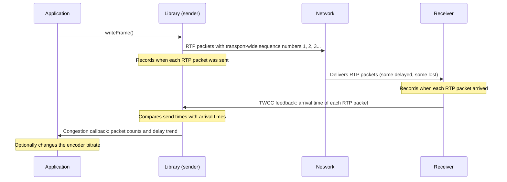
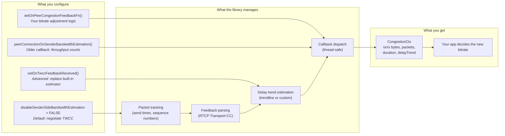

# Transport-Wide Congestion Control (TWCC)

## What is TWCC?

TWCC is RTCP feedback that tells a sender when each of its RTP packets reached the receiver. From this feedback, the KVS WebRTC C library estimates whether the network path is congested and reports the estimate to your application. Your application decides what to do with it. It can raise or lower the encoder bitrate as conditions change (adaptive or dynamic bitrate), or ignore the feedback and send at a constant bitrate.

### The problem TWCC solves

Without feedback, a sender cannot tell whether its RTP packets arrive on time, arrive late, or are lost. A sender that keeps a fixed bitrate on a congested link causes:
- Packet loss (video artifacts, freezes)
- Growing queues in network devices, which add latency
- Stalls

TWCC gives the application the feedback it needs to match the bitrate to the network.

### Overview



1. The library numbers each outgoing RTP packet with a transport-wide sequence number.
2. The receiver records when each RTP packet arrives and reports the arrival times in TWCC feedback.
3. The library compares the send times with the arrival times to estimate the delay trend, and counts the lost RTP packets.
4. The library passes the results to your application's callback. Your application decides whether to change the encoder bitrate.

### What TWCC does not do

- It does not resend lost RTP packets. Retransmission uses NACK (see [NACK / RTX](NACK_RTX.md)).
- It does not change the encoder bitrate. The library does not re-encode media: it is a pass-through that packages each frame into RTP packets, encrypts them with SRTP, and sends them as received from the application. It is up to the application to decide whether and how to apply the TWCC congestion feedback.
- It does not change RTP timestamps or when RTP packets are sent (see [Sending Media with writeFrame()](SENDING_MEDIA.md)).

---

## How it works (the protocol details)

TWCC is defined in [draft-holmer-rmcat-transport-wide-cc-extensions](https://datatracker.ietf.org/doc/html/draft-holmer-rmcat-transport-wide-cc-extensions-01). It operates at the RTP/RTCP layer:

- **RTP header extension**: Each outgoing RTP packet carries a transport-wide sequence number, separate from the per-SSRC RTP sequence number. The SDP `extmap` line negotiates the extension.
- **RTCP feedback (PT 205, FMT 15)**: The receiver sends compact reports containing a base sequence number, a packet status count, and the arrival time delta of each RTP packet.
- **Sender-side estimation**: With REMB, the receiver estimates the bandwidth. With TWCC, the sender runs the estimation algorithm, so the algorithm can change without protocol changes.

### SDP negotiation

TWCC is active only if the remote SDP includes both lines:
```
a=extmap:<id> http://www.ietf.org/id/draft-holmer-rmcat-transport-wide-cc-extensions-01
a=rtcp-fb:<pt> transport-cc
```

When the library answers an offer that includes both lines, it writes them in its answer for each media section whose offer included the `extmap` line (v1.19.0 and later).

---

## Quick Start

TWCC is enabled by default in the library (`KvsRtcConfiguration.disableSenderSideBandwidthEstimation` is FALSE). Enabled means that the library tries to negotiate TWCC. TWCC becomes active only if the remote peer supports it, that is, if the remote SDP includes both TWCC lines (see [SDP negotiation](#sdp-negotiation)). Otherwise, TWCC stays off for the session. Once TWCC is active, the library adds the TWCC extension to each RTP packet. As an optimization, the library parses the feedback only if your application registers at least one of the [callbacks](#callbacks), because otherwise nothing would receive the results.

| Goal                                | What to do                                                                                                                        |
|-------------------------------------|-----------------------------------------------------------------------------------------------------------------------------------|
| Adapt the bitrate to the network    | Register `setOnPeerCongestionFeedbackFn()` and change the encoder bitrate in your callback. The samples do this.                  |
| Send at a constant bitrate          | Register no callback. If the remote peer supports TWCC, TWCC stays active, and the library skips parsing the feedback.            |
| Turn TWCC off                       | Set `disableSenderSideBandwidthEstimation = TRUE`. The library then does not negotiate TWCC, even if the remote peer supports it. |

The samples adapt the bitrate by default:

```c
// createSampleConfiguration() sets this by default
pSampleConfiguration->enableTwcc = TRUE;

// With enableTwcc set, each streaming session registers the sample's AIMD controller,
// which computes new video and audio bitrates from the loss and delay signals
setOnPeerCongestionFeedbackFn(pPeerConnection, (UINT64) pSampleStreamingSession, sampleOnPeerCongestionFeedback);
```

The sample's `enableTwcc` flag only controls the callback and the bitrate changes. The sample leaves `disableSenderSideBandwidthEstimation` at its default, FALSE.

> [!NOTE]
> Only the **GStreamer samples** (`kvsWebrtcClientMasterGstSample`, `kvsWebrtcStorageAudioVideoMasterGstSample`, and others) apply the new bitrate to an encoder (see [How the GStreamer sample applies the new bitrate](#how-the-gstreamer-sample-applies-the-new-bitrate)). The other samples, such as `kvsWebrtcClientMaster`, send pre-encoded frames from files. They have no encoder to adjust, so their bitrate stays constant.

---

## Library Implementation

The library implements TWCC in stages. A built-in delay estimator handles the default case, and applications can register callbacks to run their own bandwidth estimation and bitrate logic.

### Where the application plugs in (configuration points)



---

## API Reference

### Callbacks

The library provides three callback registration points, ordered from most common to most advanced. The library parses TWCC feedback only if at least one of them is registered.

| Callback                                    | When to use                                                                                                     | What you receive                                                                                                                                                               |
|---------------------------------------------|-----------------------------------------------------------------------------------------------------------------|--------------------------------------------------------------------------------------------------------------------------------------------------------------------------------|
| `setOnPeerCongestionFeedbackFn`             | To adjust the bitrate based on network conditions.                                                              | `CongestionCtx` containing tx/rx bytes, tx/rx packet counts, the measurement duration, and `delayTrend` in ms per RTP packet (positive means queuing delay is growing).        |
| `setOnTwccFeedbackReceived`                 | To replace the library's built-in delay estimator (EMA-smoothed OLS linear regression) with your own algorithm. | Per-packet `TwccFeedback` array (send time, receive time, packet size for each RTP packet) and a `TwccCongestionState` struct where you write back your computed `delayTrend`. |
| `peerConnectionOnSenderBandwidthEstimation` | Older callback. Use it if you only need throughput counts, without the delay trend.                             | tx/rx bytes, tx/rx packet counts, and the measurement duration                                                                                                                 |

REMB is separate from TWCC. If the receiver sends REMB, the library passes the receiver's maximum bitrate to the callback set with `transceiverOnBandwidthEstimation()`.

### Callback priority and interaction

```
onTwccFeedbackReceived (if set)     ─┐
         OR                          ├── calculates delayTrend (slope)
built-in estimator                  ─┘
                                               │
                                               ▼
                            onPeerCongestionFeedback (if set)  -- bitrate adjustment logic
                            onSenderBandwidthEstimation (if set) -- older callback, counts without delayTrend
```

- Setting `onTwccFeedbackReceived` **replaces** the built-in OLS linear regression estimator. Your application then computes the delay trend.
- Whichever estimator produced the delay trend, the library then invokes `onPeerCongestionFeedback` and `onSenderBandwidthEstimation`, if set.

### Override Points

TWCC processing has three stages. You can replace each one independently:

| Stage                      | What it does                                                        | Default                                                                                        | Override with                                                                      | When to override                                                                               |
|----------------------------|---------------------------------------------------------------------|------------------------------------------------------------------------------------------------|------------------------------------------------------------------------------------|------------------------------------------------------------------------------------------------|
| **1. Delay estimation**    | Converts per-packet timing into a congestion signal (`delayTrend`)  | Built-in EMA-smoothed OLS trendline                                                            | `setOnTwccFeedbackReceived(pPeerConnection, customData, fn)`                       | You want a different estimator, such as GCC or SCReAM                                          |
| **2. Congestion decision** | Receives `delayTrend` and throughput stats, decides the new bitrate | None in the library. The samples use their AIMD controller (`sampleOnPeerCongestionFeedback`). | `setOnPeerCongestionFeedbackFn(pPeerConnection, customData, fn)`                   | You want different AIMD thresholds, a different algorithm, or to feed your own rate controller |
| **3. Bitrate application** | Applies the new bitrate to the media encoder                        | None in the library. The GStreamer samples call `g_object_set` on the encoder element.         | Write your own logic that reads `twccMetadata.newVideoBitrate` / `newAudioBitrate` | Your encoder needs its own API, such as a hardware encoder                                     |

<details>
<summary>Code examples for each override point</summary>

**Example 1: Override the estimator** (replace the trendline with your own algorithm):

```c
STATUS myEstimator(UINT64 customData, PTwccFeedback pFeedback, UINT32 count,
                   PTwccCongestionState pState) {
    // pFeedback[i].sendTime:   when the library sent RTP packet i (hundreds of ns)
    // pFeedback[i].recvTime:   when the remote peer received RTP packet i (hundreds of ns)
    // pFeedback[i].packetSize: bytes
    // pFeedback[i].twccSeqNum: transport-wide sequence number

    DOUBLE mySlope = runMyAlgorithm(pFeedback, count);
    pState->delayTrend = mySlope;  // Passed to the congestion decision stage
    return STATUS_SUCCESS;
}

setOnTwccFeedbackReceived(pPeerConnection, (UINT64) myApp, myEstimator);
// onPeerCongestionFeedback receives mySlope as congestionState.delayTrend
```

**Example 2: Override only the decision stage** (keep the built-in estimator, use custom bitrate logic):

```c
STATUS myBitrateCallback(UINT64 customData, PCongestionCtx pCtx) {
    MyApp* app = (MyApp*) customData;

    // pCtx->congestionState.delayTrend: from the built-in estimator (ms per RTP packet)
    // pCtx->txPackets, pCtx->rxPackets: RTP packet counts in this report
    // pCtx->txBytes, pCtx->rxBytes:     byte counts in this report
    // pCtx->duration:                   measurement window (hundreds of ns)

    // Your logic here...
    app->targetBitrate = computeMyTargetBitrate(pCtx);
    return STATUS_SUCCESS;
}

setOnPeerCongestionFeedbackFn(pPeerConnection, (UINT64) myApp, myBitrateCallback);
```

**Example 3: Change the bitrate in the application logic**:

```c
// In your frame-sending loop, instead of the GStreamer on_new_sample callback:
MUTEX_LOCK(pSession->twccMetadata.updateLock);
if (pSession->twccMetadata.newVideoBitrate != 0) {
    myEncoder_setBitrate(encoder, pSession->twccMetadata.newVideoBitrate);
    pSession->twccMetadata.newVideoBitrate = 0;
}
MUTEX_UNLOCK(pSession->twccMetadata.updateLock);
```

</details>

---

## Built-in Default Trendline Estimator

The default estimator (`computeTwccTrendline`) detects congestion by measuring whether RTP packets arrive with growing delays relative to when they were sent. It uses two statistics methods, ordinary least squares (OLS) and an exponential moving average (EMA). The [appendix](#appendix-ols-and-ema) explains both with a worked example.

### Intuition

Suppose the library sends RTP packets 10 ms apart, and the receiver reports gaps of 10, 10, 11, 12, and 14 ms between their arrivals. The gaps are growing, so a device on the path is queuing RTP packets. The trendline estimator measures this growth as a slope.

<details>
<summary>Algorithm details (OLS regression + EMA smoothing)</summary>

1. **Inter-packet delay variation**: For each **consecutive pair** of RTP packets that the report lists as received:
   ```
   delay_variation = (recv_gap) - (send_gap)
   ```
   A positive value means the network added delay between the two RTP packets.

2. **Accumulated delay**: The running sum of the delay variations. It tracks how much queuing delay has built up.

3. **Linear regression (OLS)**: Fits a line through the accumulated delay, with the sample index (0, 1, 2, ...) as x. A positive slope means delay is growing (congestion), a slope of zero means delay is stable, and a negative slope means the queues are draining.

4. **EMA smoothing**: Filters out short-term jitter, so that only sustained trends count. `alpha` is `TWCC_TRENDLINE_SMOOTHING_FACTOR` (0.2):
   ```
   smoothed = alpha * raw_slope + (1 - alpha) * previous_smoothed
   ```

5. **Output**: `delayTrend`, in milliseconds per RTP packet. A value of 0.5 means that queuing delay grew by about 0.5 ms from one RTP packet to the next. This single number drives the bandwidth decision.

</details>

---

## Sample Application: AIMD Bitrate Controller

The included sample (`sampleOnPeerCongestionFeedback` in `samples/common/Common.c`) demonstrates an AIMD (Additive Increase, Multiplicative Decrease) controller that combines a loss-based and a delay-based signal. The values below are starting points. Adjust them to your application's requirements.

### How decisions are made

The sample controller uses two independent signals and reacts to whichever indicates worse conditions:

| Signal                          | How it's measured                                      | Congested threshold | Clear threshold |
|---------------------------------|--------------------------------------------------------|--------------------:|----------------:|
| Packet loss (%)                 | `(tx_packets - rx_packets) / tx_packets`, EMA smoothed |                 > 5 |            <= 2 |
| Delay trend (ms per RTP packet) | Output of the trendline estimator                      |               > 0.5 |          < -0.1 |

When either signal indicates congestion, the controller **multiplicatively decreases** the bitrate. When conditions are clear, it **additively increases** the bitrate in small steps. The controller makes at most one adjustment every `TWCC_BITRATE_ADJUSTMENT_INTERVAL_MS` (250 ms), to limit oscillation.

<details>
<summary>Detailed AIMD factor tables</summary>

#### Decreasing bitrate (congestion detected)

The more severe the congestion, the larger the cut. The controller applies the same factor to the video and the audio bitrate.

| Condition                          |  Reduction factor  | Example: 2000 kbps →   |
|------------------------------------|:------------------:|-----------------------:|
| Delay trend > 5.0 (severe queuing) |        0.50        |              1000 kbps |
| Delay trend > 1.0                  |        0.70        |              1400 kbps |
| Loss > 10%                         |        0.70        |              1400 kbps |
| Delay trend > 0.5 (mild)           |        0.95        |              1900 kbps |
| Loss > 5%                          |        0.85        |              1700 kbps |

When both signals indicate congestion, the **minimum** (most aggressive) factor wins.

#### Increasing bitrate (network is clear)

| Condition                               | Video step                                  | Audio step                                 |
|-----------------------------------------|:-------------------------------------------:|:------------------------------------------:|
| Both loss AND delay clear               | +MAX_VIDEO/40 per interval (62 kbps)        | +MAX_AUDIO/20 per interval (6,400 bps)     |
| Only one signal clear                   | +MAX_VIDEO/80 per interval (31 kbps)        | +MAX_AUDIO/20 per interval (6,400 bps)     |
| Both neutral (not congested, not clear) | Hold (no change)                            | Hold (no change)                           |

The step sizes in parentheses use the default maximums below, with integer division.

</details>

### Bitrate bounds (CLAMP)

After every AIMD decision, the controller clamps the bitrate to a `[min, max]` range, so the encoder always receives a target within the configured bounds:

```c
// Equivalent to: CLAMP(bitrate, min, max)
videoBitrate = MAX(MIN(videoBitrate, MAX_VIDEO_BITRATE_KBPS), MIN_VIDEO_BITRATE_KBPS);
audioBitrate = MAX(MIN(audioBitrate, MAX_AUDIO_BITRATE_BPS), MIN_AUDIO_BITRATE_BPS);
```

The defaults are defined in `samples/common/Samples.h`:

| Constant                 | Default value | Unit | Notes                                  |
|--------------------------|:-------------:|------|----------------------------------------|
| `MIN_VIDEO_BITRATE_KBPS` |      384      | kbps | Floor: keeps the video quality usable  |
| `MAX_VIDEO_BITRATE_KBPS` |     2500      | kbps | Ceiling: limits bandwidth use          |
| `MIN_AUDIO_BITRATE_BPS`  |     4000      | bps  | Floor: keeps speech intelligible       |
| `MAX_AUDIO_BITRATE_BPS`  |    128000     | bps  | Ceiling: limits audio bandwidth        |

**Why the bounds matter:**
- The **minimum** keeps the controller from cutting the bitrate close to zero during short congestion. Additive increase climbs in small steps, so recovery from a very low bitrate takes a long time.
- The **maximum** limits bandwidth use, to leave room for other traffic on the link, and keeps the bitrate within what the encoder and resolution can use.

> [!TIP]
> If the minimum and maximum are equal or close, the clamp overrides every adjustment, and the bitrate stays nearly constant even though the callbacks fire (see [Troubleshooting](#bitrate-not-changing-despite-callbacks-firing)).

### How the GStreamer sample applies the new bitrate

The congestion callback stores the new target bitrate in the session's `twccMetadata`. On the next frame, the GStreamer pipeline's `on_new_sample` callback (`samples/common/GstMedia.c`) applies it:

<details>
<summary>GStreamer bitrate application code</summary>

```c
// Inside the GStreamer appsink on_new_sample callback, for each frame:
GstElement* encoder = gst_bin_get_by_name(GST_BIN(senderPipeline), "sampleVideoEncoder");
if (encoder != NULL) {
    // Get the current bitrate
    g_object_get(G_OBJECT(encoder), "bitrate", &bitrate, NULL);

    MUTEX_LOCK(pSampleStreamingSession->twccMetadata.updateLock);
    // Record the current encoder bitrate, so the AIMD logic knows where it starts
    pSampleStreamingSession->twccMetadata.currentVideoBitrate = (UINT64) bitrate;

    // If the congestion callback wrote a new target, apply it
    if (pSampleStreamingSession->twccMetadata.newVideoBitrate != 0) {
        bitrate = (guint)(pSampleStreamingSession->twccMetadata.newVideoBitrate);
        pSampleStreamingSession->twccMetadata.newVideoBitrate = 0;
        g_object_set(G_OBJECT(encoder), "bitrate", bitrate, NULL);
    }
    MUTEX_UNLOCK(pSampleStreamingSession->twccMetadata.updateLock);
}
```

This pattern decouples the RTCP processing thread, where the congestion callback runs, from the GStreamer media thread, where the encoder runs. The `updateLock` mutex protects the values that both threads share.

The same pattern applies to audio with `"sampleAudioEncoder"` and `twccMetadata.newAudioBitrate`.

</details>

> [!NOTE]
> The sample changes the bitrate only of encoder elements named `sampleVideoEncoder` and `sampleAudioEncoder`. These are the `x264enc` and `opusenc` elements in the H.264 pipelines. The H.265 test-source pipelines in `GstMedia.c` do not name their `x265enc` and `opusenc` elements, so the sample does not change their bitrate.

---

## Troubleshooting

### TWCC not activating

TWCC requires **all three** conditions. If one is missing, the peer connection logs a DEBUG message, and TWCC stays off without an error.

**Check the SDP.** Look at the remote offer or answer for these two lines in each media section (`m=audio` / `m=video`):

```
a=extmap:<id> http://www.ietf.org/id/draft-holmer-rmcat-transport-wide-cc-extensions-01
a=rtcp-fb:<payload-type> transport-cc
```

| Condition                                  | What to check                                                 | Log message if missing                            |
|--------------------------------------------|---------------------------------------------------------------|---------------------------------------------------|
| 1. Remote advertises TWCC extension        | An `a=extmap:` line containing the URL above                  | `TWCC not advertised by remote (extmap=no, ...)`  |
| 2. Remote advertises transport-cc feedback | `a=rtcp-fb:<pt> transport-cc`                                 | `TWCC not advertised by remote (..., rtcp-fb=no)` |
| 3. Local TWCC enabled                      | `disableSenderSideBandwidthEstimation` is FALSE (the default) | `TWCC disabled by local configuration`            |

**Common causes:**
- The remote peer does not support TWCC.
- The remote peer advertises TWCC on video but not on audio. Firefox does this. The library then enables TWCC only for the media sections whose offer included the `extmap` line.

### TWCC enabled but callbacks never fire

**Symptom:** `"TWCC enabled, ext id: X"` appears in the logs, but your congestion callback is never called.

| Possible cause                        | How to check                                                                                                                                                                                                                                                                     |
|---------------------------------------|----------------------------------------------------------------------------------------------------------------------------------------------------------------------------------------------------------------------------------------------------------------------------------|
| No RTP packets sent yet               | The remote peer sends feedback only after it receives RTP packets. Check that `writeFrame()` succeeds.                                                                                                                                                                           |
| Remote peer not sending RTCP feedback | Capture the traffic with Wireshark or tcpdump, and look for incoming RTCP packets with PT 205, FMT 15 on the same port as RTP (see [Inspect RTP and RTCP with Wireshark](SENDING_MEDIA.md#inspect-rtp-and-rtcp-with-wireshark)). Some peers send feedback at long intervals. |
| Callback not registered               | Register `setOnPeerCongestionFeedbackFn()` (or the older `peerConnectionOnSenderBandwidthEstimation()`) after creating the peer connection and before the connection starts.                                                                                                     |
| Duration is zero                      | The library invokes the congestion callbacks only when the measurement window (`duration`) is greater than zero. `duration` is the time between sending the first and the last RTP packet in the report, so it is zero for a report that covers one RTP packet.                  |

### Bitrate not changing despite callbacks firing

**Symptom:** `"BWE: ..."` log lines appear, but the encoder bitrate stays constant.

| Possible cause                      | How to check                                                                                                                                                                                                                                                                                                    |
|-------------------------------------|-----------------------------------------------------------------------------------------------------------------------------------------------------------------------------------------------------------------------------------------------------------------------------------------------------------------|
| Encoder element not named correctly | The GStreamer samples look up the elements named `"sampleVideoEncoder"` / `"sampleAudioEncoder"`. If an element has a different name or no name, `gst_bin_get_by_name()` returns NULL, and the sample skips the change without logging it. The sample's H.265 test-source pipelines do not name their encoders. |
| `updateLock` contention             | If the media thread cannot take `updateLock`, it never applies the new bitrate. Check for deadlocks or long lock holds.                                                                                                                                                                                         |
| Bitrate clamped to min/max          | The sample clamps to `MIN_VIDEO_BITRATE_KBPS` / `MAX_VIDEO_BITRATE_KBPS`. If the minimum equals the maximum, the bitrate does not change.                                                                                                                                                                       |
| Not using GStreamer                 | The sample's bitrate application code is specific to GStreamer. With another encoder, read `twccMetadata.newVideoBitrate` and apply it yourself (see [Override Points](#override-points)).                                                                                                                      |

### Useful log messages

Set the log level to `DEBUG` (`AWS_KVS_LOG_LEVEL=2` in the samples) to see the TWCC diagnostics. Key messages to look for:

<details>
<summary>Log message reference</summary>

| Log message                                                      | What it means                                                                                                                                                                                                                |
|------------------------------------------------------------------|------------------------------------------------------------------------------------------------------------------------------------------------------------------------------------------------------------------------------|
| `TWCC enabled, ext id: <N>`                                      | TWCC negotiated successfully. `N` is the RTP extension ID.                                                                                                                                                                   |
| `TWCC disabled by local configuration`                           | `disableSenderSideBandwidthEstimation` is TRUE, so the peer connection does not track RTP packets for TWCC.                                                                                                                  |
| `TWCC not advertised by remote (extmap=X, rtcp-fb=Y)`            | The remote SDP is missing one or both required attributes.                                                                                                                                                                   |
| `TWCC trendline: delayTrend=X ms queueDelay=Y ms (n=Z)`          | Output of the built-in estimator. `delayTrend` is in ms per RTP packet. A positive value means queuing delay is growing. `queueDelay` is the accumulated delay over the report.                                              |
| `BWE: pktLoss=X% delayTrend=Y ms factor=Z`                       | The sample AIMD controller made a bitrate decision. Shows the smoothed loss, the delay trend, the factor (0 for an additive increase), the resulting bitrates, and the byte and RTP packet counts.                           |
| `Malformed TWCC packet: packetStatusCount is 0, skipping`        | The library received an empty feedback report and skipped it.                                                                                                                                                                |
| `Malformed TWCC packet: reportLen X exceeds packetStatusCount Y` | The report's sequence number range is longer than its packet status count. The library limits the report to the packet status count.                                                                                         |
| `Number of TWCC info packets in memory: N`                       | Logged at INFO when the peer connection is freed. `N` counts the RTP packets that the library still tracked for TWCC: those sent in the last 4 seconds (`TWCC_ESTIMATOR_TIME_WINDOW`) that no feedback reported as received. |

</details>

---

## Appendix: OLS and EMA

The built-in trendline estimator uses two common statistics methods. This appendix explains them, using the RTP packets from [Intuition](#intuition) as the example.

### OLS (ordinary least squares)

OLS fits a straight line through a set of points. Of all possible lines, it chooses the one with the smallest sum of squared vertical distances to the points. The slope of that line is the average change in y for each step in x:

```
slope = (n × Σxy − Σx × Σy) / (n × Σx² − (Σx)²)
```

In the trendline estimator, each point is one RTP packet in a TWCC report. x is the RTP packet's index in the report (0, 1, 2, ...), and y is the accumulated delay in ms. The slope is therefore in ms per RTP packet.

In the example, the library sends RTP packets 10 ms apart, and they arrive 10, 10, 11, 12, and 14 ms apart. The delay variations are 0, 0, 1, 2, and 4 ms, so the accumulated delays are 0, 0, 1, 3, and 7 ms:

| x (index) |  y (accumulated delay, ms) |    x × y |       x² |
|----------:|---------------------------:|---------:|---------:|
|         0 |                          0 |        0 |        0 |
|         1 |                          0 |        0 |        1 |
|         2 |                          1 |        2 |        4 |
|         3 |                          3 |        9 |        9 |
|         4 |                          7 |       28 |       16 |
|   Σx = 10 |                    Σy = 11 | Σxy = 39 | Σx² = 30 |

With n = 5 points, the slope is (5 × 39 − 10 × 11) / (5 × 30 − 10²) = 85 / 50 = 1.7 ms per RTP packet. The slope is positive, so queuing delay is building up.

### EMA (exponential moving average)

An EMA is a running average that gives the newest value a fixed weight, alpha, and the previous average the rest:

```
smoothed = alpha × raw_slope + (1 − alpha) × previous_smoothed
```

`alpha` is `TWCC_TRENDLINE_SMOOTHING_FACTOR` (0.2), so each new report's slope counts for 20%, and the weight of older reports shrinks by a factor of 0.8 with every report. The smoothed value starts at 0. If three reports in a row have the raw slope of 1.7 from the example:

|  Report |  Raw slope (ms per RTP packet) | `delayTrend` after smoothing  |
|--------:|-------------------------------:|-------------------------------|
|       1 |                            1.7 | 0.2 × 1.7 + 0.8 × 0 = 0.34    |
|       2 |                            1.7 | 0.2 × 1.7 + 0.8 × 0.34 = 0.61 |
|       3 |                            1.7 | 0.2 × 1.7 + 0.8 × 0.61 = 0.83 |

A single report with a high slope moves `delayTrend` by only 20% of that slope, so short bursts of jitter have little effect, while a sustained trend builds up over a few reports. In the sample AIMD controller, which treats a delay trend above 0.5 as congestion, report 1 (0.34) does not trigger a decrease, and report 2 (0.61) does.
